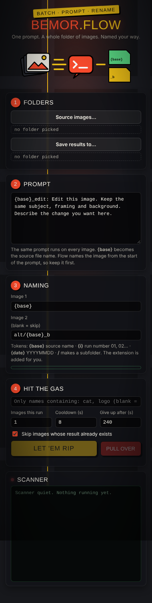

<p align="center"></p>

<h1 align="center">Bemor.Flow</h1>
<p align="center"><b>One prompt. A whole folder of images. Named your way.</b></p>
<p align="center">A free, open-source Chrome extension that runs the same <a href="https://labs.google/fx/tools/flow">Google Flow</a> image edit over every image in a folder and saves the results with your own file names.</p>

<p align="center">
  <a href="#install">Install</a> ·
  <a href="#quick-start">Quick start</a> ·
  <a href="#naming-your-results">Naming</a> ·
  <a href="#example-prompts">Examples</a> ·
  <a href="#troubleshooting">Troubleshooting</a> ·
  <a href="#support-the-project">Support</a>
</p>

<p align="center"><a href="https://github.com/bemor187/Bemor.Flow/raw/main/dist/Bemor.Flow-v0.3.1.zip"><b>⬇ Download Bemor.Flow v0.3.1</b></a></p>

<p align="center"></p>

---

## Why
Making the same edit to 50 images in Flow by hand means 50 uploads, 50 prompts, 50 downloads and 50 renames. Bemor.Flow does all of that while you do something else:

- Takes every `.jpg`, `.png` and `.webp` in a folder.
- Uploads each one to your Flow project, attaches it, types your prompt and clicks Generate.
- Saves the results straight into your output folder, named with a **pattern** you choose.
- Skips images that are already done, so you can stop at any time and pick up where you left off.

**Good for:** product photos on a new background · one style across a whole photo set · game sprite variants (damaged, night, snow) · real-estate photo clean-up · consistent edits over a shoot.

## Requirements
- Google Chrome 116 or newer (desktop). Other Chromium browsers such as Edge and Brave usually work too.
- A Google account with access to Google Flow, and Flow credits. **Every image uses one generation.**

## Install
Bemor.Flow isn't on the Chrome Web Store yet, so you load it yourself. It takes about two minutes.

1. **Download.** Grab **[Bemor.Flow-v0.3.1.zip](https://github.com/bemor187/Bemor.Flow/raw/main/dist/Bemor.Flow-v0.3.1.zip)** and unzip it somewhere you'll keep it, e.g. `Documents\Bemor.Flow`.
2. **Open extensions.** In Chrome, go to `chrome://extensions`.
3. **Developer mode.** Switch on **Developer mode** (top right).
4. **Load it.** Click **Load unpacked** and select the unzipped **`Bemor.Flow`** folder (the one that contains `manifest.json`). If you cloned the repo instead, pick its `extension` folder.
5. **Pin it.** Click the puzzle-piece icon in Chrome's toolbar and pin **Bemor.Flow**.

**Updating:** download the newest ZIP from the [`dist`](dist) folder, replace the old folder, then press ↻ on the Bemor.Flow card in `chrome://extensions`.

## Quick start
1. **Open Flow.** Go to Google Flow, open or create a project (the address looks like `flow.google.com/project/...`), and make sure you're signed in.
2. **Open the panel.** Click the Bemor.Flow icon. The panel opens in Chrome's side panel, right next to Flow.
3. **① Folders**
   - **Source images…**: the folder with the images you want to edit.
   - **Save results to…**: an empty folder for the results. Chrome asks permission to save there; allow it.
4. **② Prompt.** Write one prompt that works for every image, and start it with `{base}_something:`, for example:
   ```
   {base}_studio: Edit this image. Same product, same angle and framing. Put it on a clean white studio background with a soft shadow.
   ```
   Flow names its image from the first words of the prompt, so starting with `{base}` keeps names traceable.
5. **③ Naming.** Leave the defaults to start (see [below](#naming-your-results)).
6. **④ Hit the gas.**
   - Leave **Images this run** at **1** for your first test.
   - Click **LET 'EM RIP** and **keep the Flow tab visible** while it runs. Chrome slows down hidden tabs.
   - Watch the **Scanner** box. When it says `saved`, check the result in your output folder.
7. Happy with it? Raise **Images this run** (e.g. 50) and run again. With **Skip images whose result already exists** ticked, finished images are left alone.

Click **PULL OVER** to stop after the current image.

### Settings
| Setting | What it does |
|---|---|
| Only names containing | Run just the images whose names contain these words, comma-separated. Blank means all. |
| Images this run | Maximum number of images to process in this run. |
| Cooldown (s) | Pause between images. Be gentle with Flow; 8 seconds or more is a good default. |
| Give up after (s) | How long to wait for Flow to finish one image before marking it failed. |
| Retries | How many more times to try an image that fails (default 2). Each try reloads Flow first. A retry after Generate was clicked uses another generation. |
| Skip images whose result already exists | Leaves alone any image whose Image 1 output file is already in the output folder. |

## Naming your results
Flow returns two images for every generation. You choose a name pattern for each.

| Token | Becomes | Example |
|---|---|---|
| `{base}` | the source file name without its extension | `sneaker_red` |
| `{i}` | the image's position in this run | `01`, `02`, `03` |
| `{date}` | today's date, YYYYMMDD | `20261028` |
| `/` | a subfolder (created for you) | `alt/{base}` |

The file extension (`.jpg`, `.png`, `.webp`) is added automatically. **Leave Image 2 blank** to keep only the first result. The panel shows a live preview of the names.

**Examples** for the source file `sneaker_red.png`:

| Image 1 pattern | Image 2 pattern | Saved as |
|---|---|---|
| `{base}` | `alt/{base}_b` | `sneaker_red.jpg` + `alt/sneaker_red_b.jpg` (default) |
| `{base}_studio` | *(blank)* | `sneaker_red_studio.jpg` |
| `{date}/{i}_{base}` | `{date}/{i}_{base}_alt` | `20261028/01_sneaker_red.jpg` + `20261028/01_sneaker_red_alt.jpg` |
| `v1/{base}` | `v2/{base}` | `v1/sneaker_red.jpg` + `v2/sneaker_red.jpg` |

### Rename map (optional)
`extension/renamemap.json` lets you swap a source file name for a better one before naming, which is handy when the sources are camera or download names:
```json
{ "IMG_0042.jpg": "hero_shot.jpg", "IMG_0043.jpg": "side_view.jpg" }
```
After editing it, press ↻ on the extension. Leave it as `{}` if you don't need it.

## Example prompts
Start each one with `{base}_<tag>:` and describe what to keep as well as what to change. Being explicit about what stays the same is what keeps a batch consistent.

- **Product shots:** `{base}_white: Edit this image. Same product, same angle, same size in frame. Pure white seamless background, soft natural shadow underneath. No text.`
- **Season change:** `{base}_winter: Edit this image. Same scene and camera angle. Make it a snowy winter day: snow on the ground and roofs, overcast sky. Keep every building and object in place.`
- **Game sprite variant:** `{base}_wrecked: Edit this image. Same car, same top-down view, position and scale, plain white background. Show it after a crash: crushed front end, dents, scratched paint. No debris, no shadows.`
- **Style pass:** `{base}_ink: Redraw this image as a black ink illustration with clean line work on white paper. Same composition.`

## Troubleshooting
| Scanner says | What to do |
|---|---|
| `Open your Flow project ... in a tab first` | Open a Flow **project** page (`flow.google.com/project/...`), not the Flow home page. |
| `Flow page did not become ready` | Check that you're signed in and that no popup or banner is covering Flow. Keep the Flow tab in front and try again. |
| `Upload media button never appeared` | Flow's layout may have changed. Widen the Flow window and retry. If it keeps happening, open an issue with the full message. |
| `Timed out waiting for uploaded asset` | The upload didn't show up in Flow's picker. Retry; if it repeats, open an issue with the Scanner lines. |
| `Generation timed out` | Flow was slow or refused the prompt. Raise **Give up after**, or check the Flow tab for a policy or credit message. |
| `Could not type the prompt into Flow` | Click into the Flow page once and run again. |

**"Started debugging this browser" bar:** this is expected. Flow ignores clicks made by scripts, so Bemor.Flow sends a real click through Chrome's debugger API. It attaches only to the Flow tab, only for that click, then detaches.

**Nothing happens when I click the icon:** go to `chrome://extensions`, press ↻ on Bemor.Flow, and reload the Flow tab.

## Privacy and safety
- Everything runs locally in your browser. Bemor.Flow has no server, no tracking and no analytics.
- Your images go only to Google Flow, in your own signed-in session, just as if you uploaded them by hand.
- Permissions used: `tabs` (find the Flow tab), `debugger` (real clicks on the Flow tab), `sidePanel` (the panel), and access to `flow.google.com` only.
- The extension can read and write only the folders you pick, and only while the panel is open.

## Disclaimer
Bemor.Flow is an unofficial community tool. It is not affiliated with or endorsed by Google. It automates your own Flow session, so you're responsible for using it within Google's terms and for the credits it uses. Flow's page changes from time to time, which can break automation until Bemor.Flow is updated.

## Roadmap
More features are on the way. Ideas so far:
- [ ] Prompt presets you can save and switch between
- [ ] Per-image prompts from a CSV
- [ ] Before/after preview gallery in the panel
- [ ] Chrome Web Store release

Have an idea? [Open an issue](../../issues/new).

## Contributing
Bug reports, ideas and pull requests are welcome. See [CONTRIBUTING.md](CONTRIBUTING.md).

## Support the project
Bemor.Flow is free and always will be. If it saves you time:
- ⭐ **Star this repo.** It helps other people find it.
- 📣 **Share it** with a before/after of what you made, and tag the repo.
- ☕ **Donate:** *link coming soon.*

## License
[MIT](LICENSE) © bemor187
